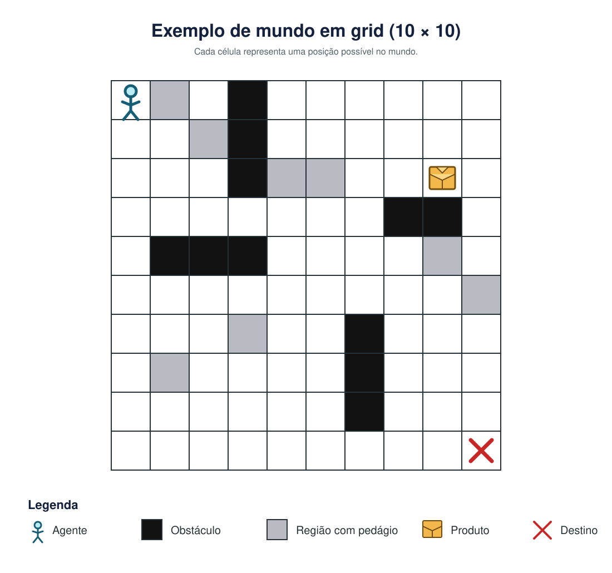

### IA e Robótica APS4 Exercício de prova

#### Membros:
- Humberto Filho Castello Branco Lages Rebello e Castro

Nesse exercício irei apresentar uma solução para o problema proposto no link abaixo:
-  <a href="https://insper.github.io/ia_bcc/aulas/16_revisao_prova/prova/"> Enunciado da APS </a>

O mundo é descrito como:
- 


- 

O arquivo principal é o main.py. Nele também se encontra a função cria_mapa(n) que recebe o argumento n (tamanho do mapa)
e cria um mapa semelhante ao da imagem supracitada. Nele, aproximadamente 8% das casas são pedágios e 11% das casas
são obstáculos (pode variar conforme a função de geração de mapa), com um pacote num local aleatório, entregador inicia num local aleatório e o destino está num local aleatório também.

Ele usa o algoritmo A Estrela com uma heurística baseada na distância de manhattan definida por:
$$
    \begin{cases}
    h(n) = d(atual, pacote) + d(pacote, destino) + 2 \\ 
    h(n) = d(atual, destino) + 1 \\ 
    h(n) = 0 \\ 
    \end{cases}
$$

Com $d(x,y) = |x_a - x_b| + |y_a - y_b|$

Para, respectivamente: antes de pegar a encomenda, após pegar a encomenda e após deixar a encomenda ao destino.

O entregador pode se mover com custo 1, se mover com pedágio irá ocasionar em custo 3 (custo + 2), pegar a encomenda e entregar ela ao destino também terá custo 1.

Para executar basta instalar a biblioteca aigyminsper e executar:

```
python main.py
```

Após isso aparecerá no terminal a frase "Qual o tamanho do mapa?" e você digitará um número inteiro n que irá gerar o 
mapa de dimensões nxn.

Para verificar se há solução, dado que a geração dos obstáculos, pedágios, posição inicial, pacote e destino são aleatórios foi feito um mecanismo de verificação usando Busca em Largura para ver se o caminho é possível de ser alcançado ou se está com obstáculos em volta através da função tem_solucao().